# Sancho Panza · Age of Empires 2 Fan Companion

**A coach that sits next to you while you play Age of Empires II: Definitive Edition.**
You type (or ask) what is happening in your game — "I'm Franks vs Mongols in Castle Age and he makes Mangudai" — and it answers at once with the **match sheet**: what beats what, the two civs, the map and the builds that fit, all from current game data, ~1,000 videos and guides from top players, and duel maths. It works with no AI and no key at all (nothing leaves your PC); with your own AI key it can also read your messages for you and give a concrete plan as a free coach. It can read the answer aloud.

Read this in: **English** · [Español](README.es.md)

| | |
|---|---|
| **Windows** | [Latest release](https://github.com/Mdatas/sancho-panza/releases/latest) → `SanchoPanza-…-windows-x64.zip` → unzip → `Instalar.bat` |
| **Mac** (Apple chip or Intel) | [Latest release](https://github.com/Mdatas/sancho-panza/releases/latest) → `SanchoPanza-…-mac-arm64.zip` (M1–M4) or `…-mac-x64.zip` (Intel) |
| **Web / Android / iPhone** | https://mdatas.github.io/sancho-panza/ → browser menu → "Add to Home screen" |
| **Languages** | Español · English · Deutsch · Português · 中文 · Tiếng Việt · 한국어 |
| **License** | Non-commercial, share-alike, fair-play — see [LICENSE](LICENSE) |

---

## Screenshots

<p align="center">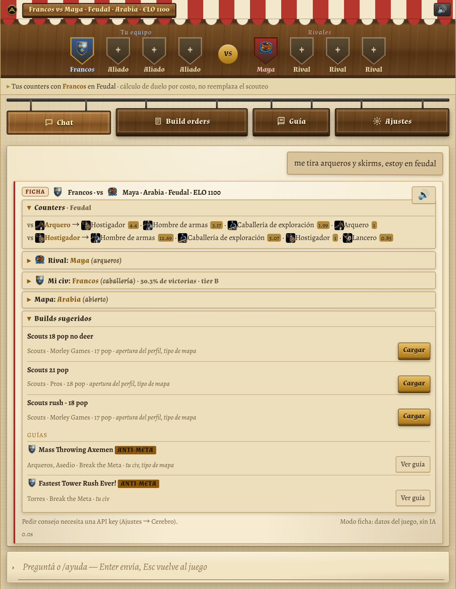</p>
<p align="center"><em>The <strong>match sheet</strong> (default answer mode): what the rival makes and what beats it, the two civs, the map and the builds that fit — built from the data, no AI writing</em></p>

<p align="center">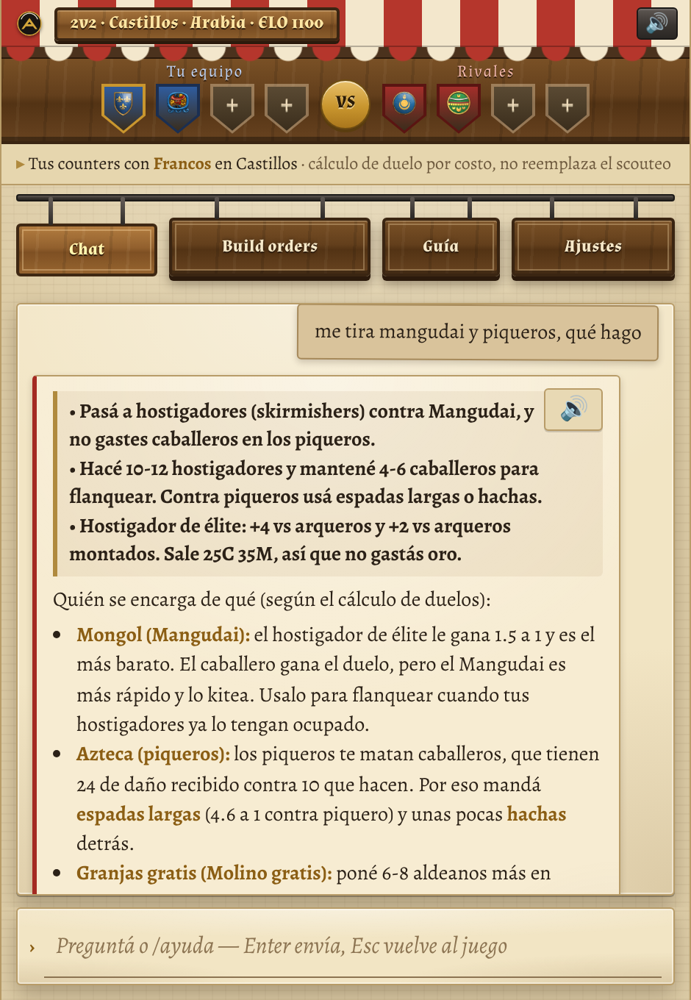 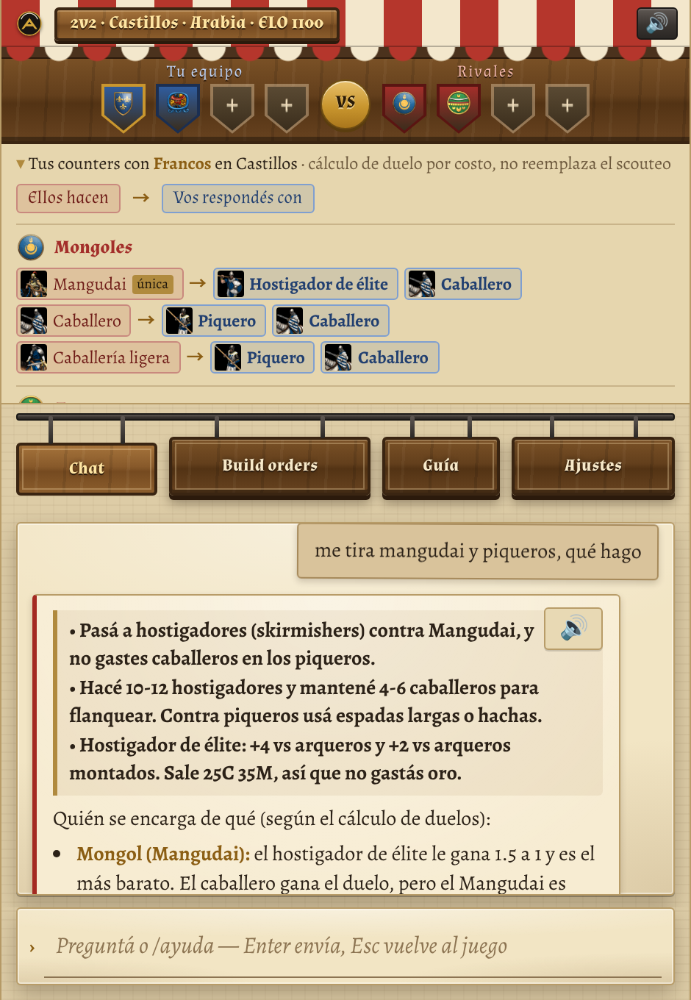 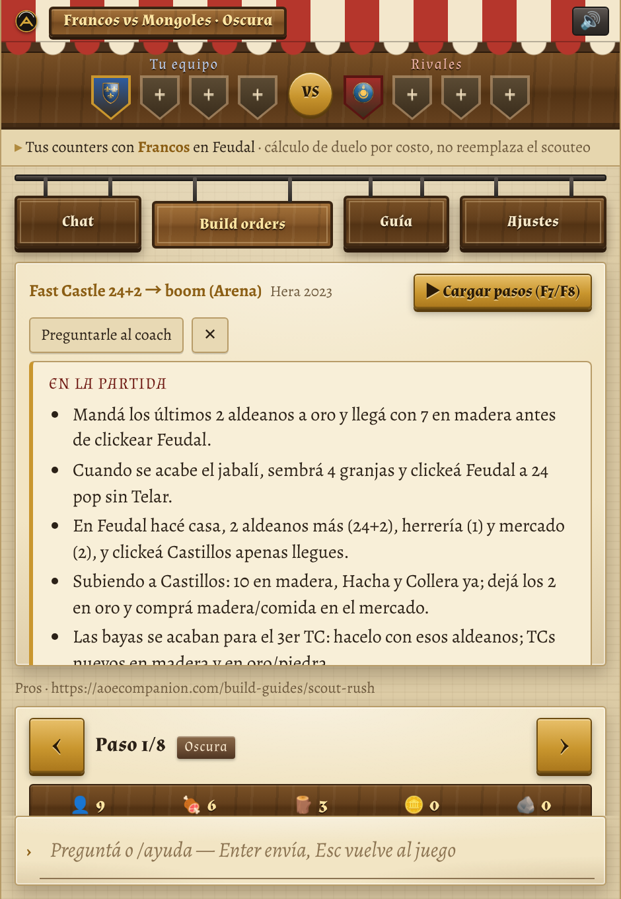</p>
<p align="center"><em>Free chat with the 3-line summary · the 4 v 4 bar and its counters · a guide condensed “for the game” with “Load steps”</em></p>

<p align="center">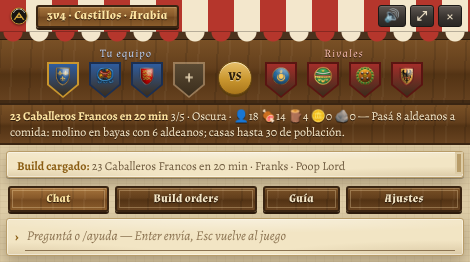</p>
<p align="center"><em>The compact overlay (470 × 262) that stays on top of the game: current build step, last answer, question line</em></p>

<p align="center">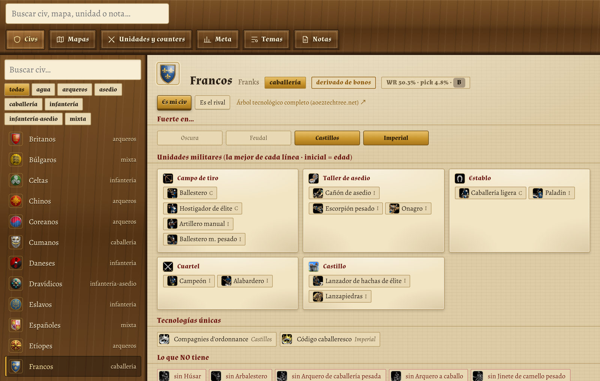 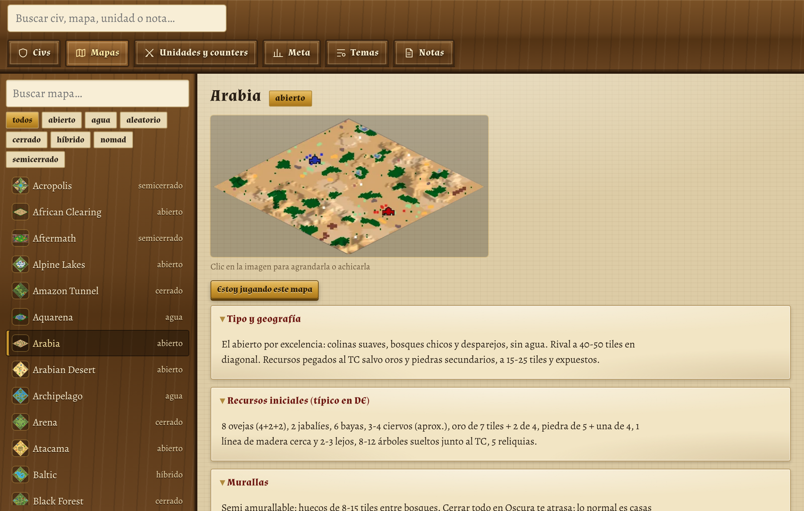</p>
<p align="center">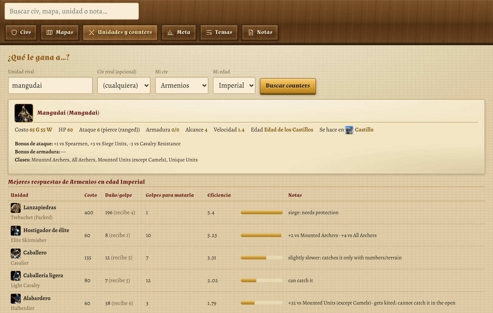 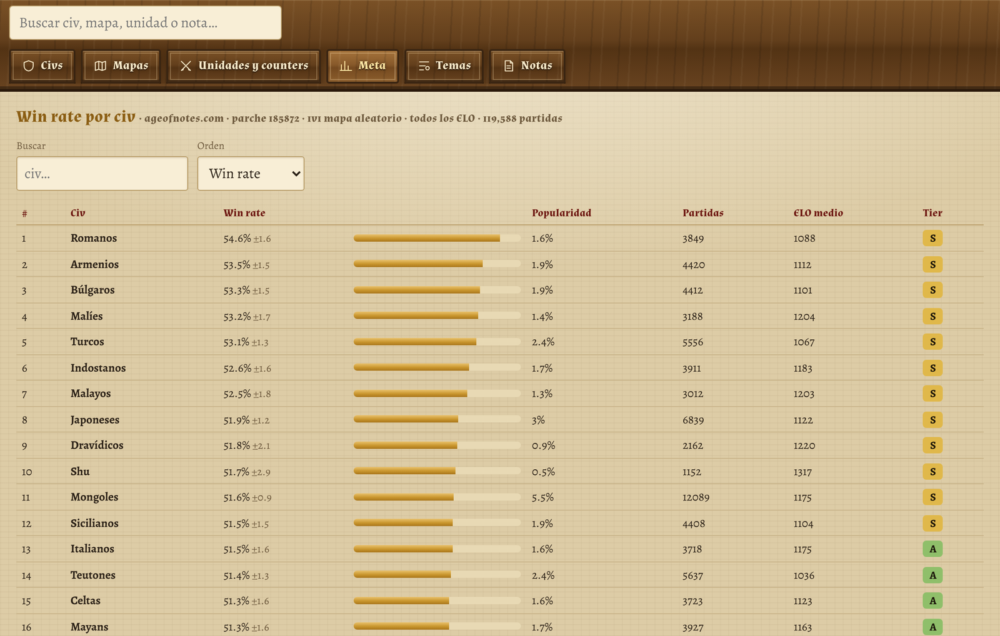 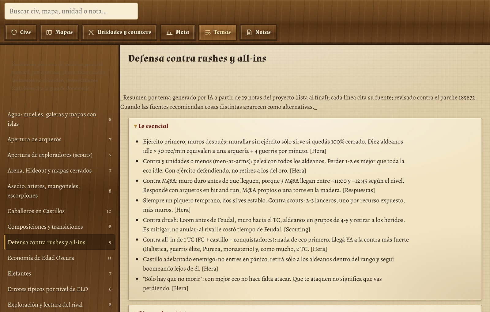</p>
<p align="center"><em>The guide: civs, maps with their picture, “what beats…?”, <strong>Meta by civ</strong> (opening per map type + loadable builds) and the 24 <strong>Pro tips</strong></em></p>

<p align="center">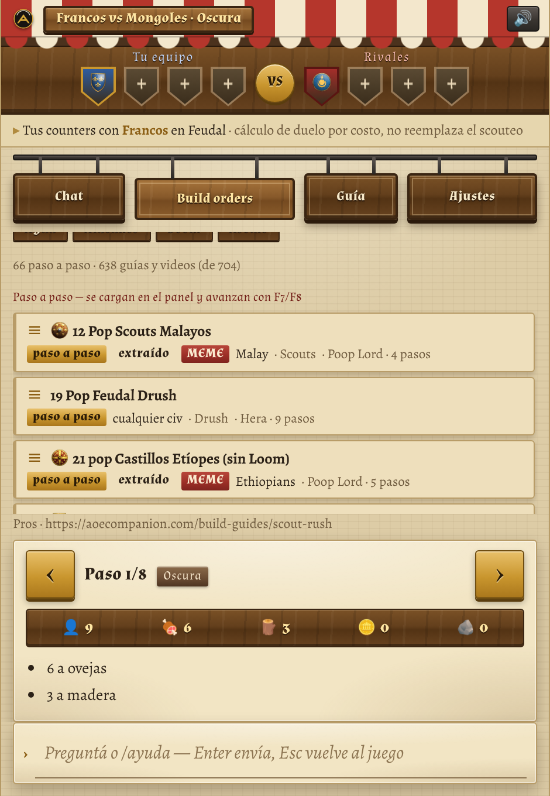 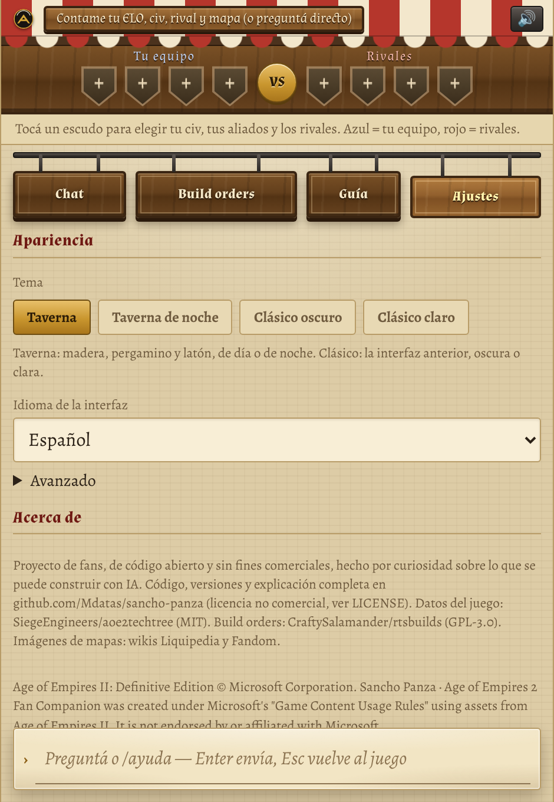 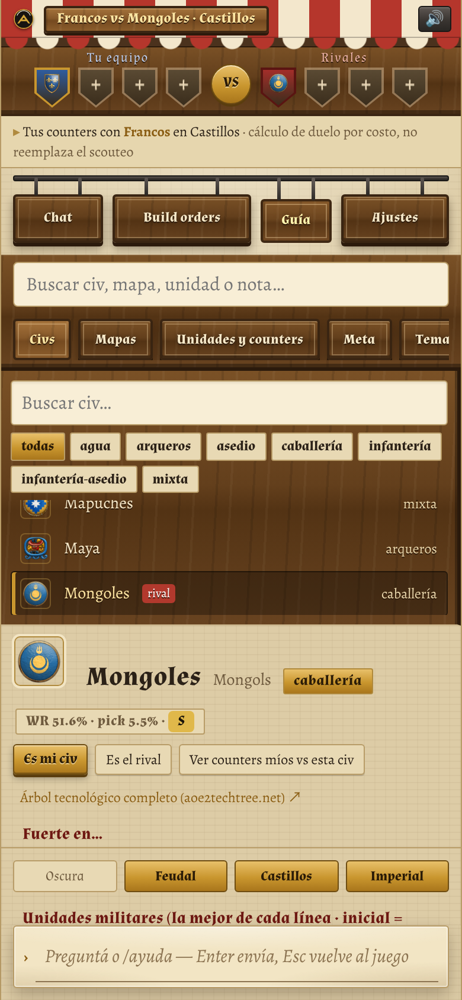</p>
<p align="center"><em>Build orders (catalogue + step panel) · Settings → Appearance · the web version on a phone</em></p>

<p align="center">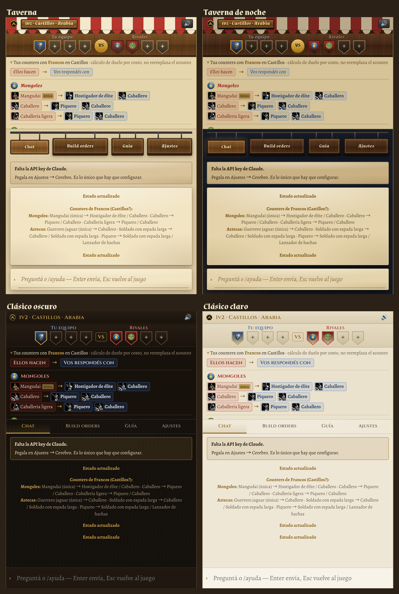</p>
<p align="center"><em>The four looks: Tavern (default), Tavern at night, Classic dark, Classic light — <a href="screenshots/guide-night.png">the guide at night</a></em></p>

## Why it exists

This was made **out of curiosity about what can be done with AI — purely for joy and intellectual curiosity.**
The question was simple: how far can one person get, talking to an AI, building a real tool that helps people enjoy and understand a 25-year-old strategy game better? Everything here — code, research, data checks, translations, this page — was built in conversation with Claude (Anthropic), with a human deciding what to build and checking the results.

It is free, it has no ads, it collects nothing, and it will stay non-commercial.

## What it is not

* **Not a cheat or a bot.** It never reads the game's memory or network traffic, and never clicks or types in the game. It only answers what *you* tell it; the optional screen reading (off by default) looks at the resource bar on your own screen — the same numbers a spectator sees — and nothing else. The license forbids using it for cheating or any unfair play.
* **Not affiliated** with Microsoft, World's Edge, Forgotten Empires or any creator credited below.
* **Not always right.** It is an AI: numbers come from game data tools, but advice can be wrong. It tells you when a tip is old, off-meta or a meme.

---

## How it works

Three answer modes, chosen in the welcome popup or in Settings → Brain (or `/mode`). Each one explains what it does, what leaves your PC and what it costs before you pick it:

```
 Local (default, no AI) ─ you ──► app ──► 1. a keyword parser reads the match facts from your message (civs, map, age, what they make)
                                          2. builds the sheet from the data: counters to what they make, your civ, the rival civ, the map, the builds that fit
                                          3. nothing is written by a model and nothing leaves your PC: every line comes from the tech tree,
                                             the profiles, the duel maths or the catalogue. No key, no cost.

 Sheet + AI ─ you ──► app ──► the same sheet, but a cheap model (Claude Haiku) parses your message — it understands free text, typos,
                              English/Spanish mixes and "he's going knights" — ~US$0.0002 per message; "Ask the AI for advice" is one click away

 Free coach (AI) ─ you ──(text or voice)──► app ──► 1. extracts the match facts (civs, age, map, armies, constraints)
                                                    2. picks the relevant knowledge (civ & map profiles, notes, team counters)
                                                    3. asks the AI with tools: counters, civ info, unit stats, eco plan, build orders, note search
                                                    4. answer = 3-line summary + short detail, read aloud (~US$0.03–0.05 with Claude Sonnet)
```

* **Game data** (all civs, units, techs, bonuses, costs, armour classes) comes from the official game files as published by [SiegeEngineers/aoe2techtree](https://github.com/SiegeEngineers/aoe2techtree), updated every patch. The AI is told never to quote numbers from memory: it must ask the tools.
* **Duel maths**: an own engine simulates stand-and-fight duels with attack/armour classes, bonus damage, upgrades and cost, and ranks the best answers your civ has against a unit (with a kiting correction for ranged vs melee).
* **Knowledge base**: ~3,100 sections of notes in Spanish, summarised from ~1,000 videos and guides (see Sources). Every note has its **publish date** and a **VIGENCIA** (validity) block checked against the full patch history up to the current patch (185872): what changed since the video and what is true today.
* **Meta / anti-meta / meme**: every strategy is tagged. META = standard, high win rate at your level. ANTI-META = works under conditions (map, civ, ELO, surprise). MEME = cheese for fun or to learn how to stop it. The coach says the tier and never sells a meme as the standard plan.
* **Patches**: on start (once a day) the desktop app reads the official news feed of ageofempires.com; if a new AoE2 patch appears it saves the official text as a note and the coach reads it before quoting numbers.

## Features

**Match sheet** (local and sheet + AI modes, v0.22–0.23)
* Every message gets a **sheet built only from the data**: counters to the units named (or to the rival's registered army, or to the rival civ's typical units) with unit cards, **your civ** (strength by age, bonuses, unique unit and techs, what it lacks, the profile's opening for this kind of map), **the rival civ** (the same plus "how to play against it"), **the map** (what wins there, standard openings, timings, its picture, the line about your rival's civ) and **suggested builds**: 3 meta step-by-step builds that fit your civ, the map type and the profile's opening — one click loads them into the build panel — plus anti-meta guides for your civ.
* **Local mode (default)** needs no key and sends nothing anywhere: a keyword parser reads your message (it knows the civ, map and unit names in Spanish and English, "I'm X vs Y", "soy francos", allies and enemies, ages, ELO). **Sheet + AI** replaces the parser with Claude Haiku (~US$0.0002 per message) for free text and typos; the local parser fills whatever the model leaves blank. The sheet also works on the web with no key.
* It never ventures a concrete plan by itself: **"Ask the AI for advice"** (or `/advice`, with a key) asks the free coach for one, with the sheet in its prompt so the advice cites it instead of starting over. `/sheet` shows the sheet for the current match; it is also posted when a match is detected.

**Chat coach** (free mode)
* Compact overlay that stays on top of the game (borderless window), or a full window.
* Answers start with a **3-line summary** (decision · what to make, with numbers · the key fact), then a short detail. The answer is **streamed** while the model writes it, and the summary is read aloud as soon as it is complete.
* Before the model answers, the app pre-computes the counters to the army you registered ("me tira mangudai") and the team counters, so most questions need fewer tool rounds; the match-fact extraction runs in parallel with the answer.
* **Prompt cache** on by default (the fixed rules and the per-question notes are separate cached blocks): about US$0.03–0.05 per question with Claude Sonnet; the cost is shown under every answer.
* **Voice**: natural neural voices (Microsoft Edge, free) in each language — Elena (Argentina) by default; offline fallback to the system voice. A 🔊 button inside every answer re-reads it.
* Remembers the match state for the session and asks only what it needs ("To refine: your ELO?").
* Friendly explanations when the API key fails (missing, invalid, no credit, rate limit, offline).

**4 vs 4 team bar**
* Set your civ, up to 3 allies and up to 4 enemies (click a slot, type `/allies` `/enemies`, or just say it).
* For each enemy civ it computes their likely main units at your age (unique unit + signature lines) and **your best counters** to each, with icons.

**Build orders**
* 66 step-by-step builds that advance with F7/F8 and can be read aloud: 41 from rtsbuilds (Hera, Morley Games, DauT, TaToH…) and 25 **extracted by AI from the project's own guide notes** — each step carries the sentence of the note that supports it, and a build was kept only when every quote was found verbatim in the note (tagged *extraído*, with its meta/meme tier).
* **Step card** (v0.23), made to be read mid-game in the overlay: ‹ › arrows, step number, age and the step's clock, the villager allocation as icons (👤 🍖 🪵 🪙 🪨), the step text, the **next step** in small print, a countdown to it when the clock runs, and a ▾ button that folds the card to one line. The full panel also lists **all the steps** of the build (click one to jump there).
* **Finding a build** (v0.23): the catalogue is sorted by relevance to your match (your civ's builds first, then the meta ones), and with a civ and a map set a **"For your match"** group at the top shows the builds that fit your civ, the map type and the profile's opening — the same ones the sheet suggests. The guide's *Meta by civ* page loads a build into the panel with one click.
* **Build clock**: press ▶ when the game starts and the steps advance by their time stamp; if you move a step by hand it tells you how many seconds ahead or behind the build you are. A generic build shows the start/eco bonuses of the civ you registered.
* Graded timing **benchmarks** (A+ … E) for the standard builds (Feudal/Castle click, first army), from Cicero's build-order reference, available to the coach as a tool.
* ~640 build/strategy guides from videos, browsable as cards with filters: civ, type (Scouts, Archers, Drush, Fast Castle, Towers, TC drop, Castle drop, Water, Boom…), source, and meta/anti-meta/meme. Each opens with an **"En la partida" block** (3–6 lines with the numbers that matter, patch corrections already applied, condensed by AI from the note) and the full note folded underneath.
* Import your own builds (buildorderguide.com / RTS Overlay JSON).

**Visual guide** (📖)
* 56 civs with icons: units by building, what they lack, strong ages, win rates.
* 129 maps with profiles and the in-game minimap picture for almost all of them (from the Liquipedia and Fandom wikis; the few without one show an emblem for their type).
* "What beats…?" counter calculator with unit stats.
* **Meta by civ** (v0.23): pick a civ and see its meta opening for open, closed and water maps with the step-by-step builds that follow it (one click loads them into the build panel), its Castle and Imperial plan, its compositions, how it is played against, its patch win rate and its guides by tier (meta, anti-meta, memes). The full win-rate/pick-rate table of the patch is folded underneath.
* Icons for civs, units and technologies (unique techs and everything a civ lacks).
* **Pro tips** (Consejos pro): 24 summaries by theme — scouts, archers, men-at-arms/drush, fast castle & boom, knights, towers, TC/castle drop, monks, siege, water, elephants, villager rush, Dark Age economy, defending rushes, walls, scouting, compositions, closed maps, Nomad, team games, late game, micro, mistakes by ELO, macro benchmarks — each with the essentials, how it is done, **alternatives where the guides disagree**, typical mistakes and counters; every line cites its guide. The coach reads them for general questions.
* One search box for everything: civs, maps, units and notes.
* Full-text search over all notes (BM25 index with bilingual stemming and alias folding: "malienses", "malians" and "malíes" are one term).
* The interface is translated into all 7 languages. Civ/map profiles and notes are written in Spanish: in any other language a 🌐 *Translate* button on each section translates it with your own AI key (a fraction of a cent per section, cached on your device).

**Optional match detection**
* Off by default. If you set your public AoE2 profile, it reads your current match (civs, map, teams) from the community service aoe2companion and fills what you have not typed. Your own input always wins.

**Optional screen reading (OCR, desktop, experimental)**
* Off by default. Every 5–120 s it captures the game's **resource bar** (wood, food, gold, stone, villagers on each, population, idle villagers, age, game clock) and shows the numbers under the state line. The loaded build's step compares its villager allocation with what the bar says ("+2 🪵 for the step"), the **build clock syncs itself to the game clock**, the age registered moves forward when the bar shows a new one, and the coach gets the fresh numbers in its prompt.
* Two engines (Settings → Advanced): **Local** (default, v0.23) reads the digits on your own PC with [Tesseract](https://github.com/naptha/tesseract.js) — the crop never leaves the machine, costs nothing and takes ~0.4 s; the app isolates each number itself (text mask by colour — white stockpiles, yellow villager counts, cyan total villagers —, connected components, per-word recognition with a digit whitelist) because the bar's outlined digits on the wooden frame defeat whole-line OCR. **AI** sends only that crop to your provider's vision model (Claude Haiku: ~US$0.0003 per reading, about US$0.07 per hour at 15 s) and understands any HUD scale or mod. *Calibrate* finds the bar on your screen once (locally, by the dark band of its resource boxes; the region always reaches the game clock at the top centre); if it misses, *Mark by hand* lets you click the two corners on a screenshot; *Test* shows the crop with the boxes of every word it read. Readings are skipped while the picture does not change and the loop backs off when the game is not on screen. Needs the game in borderless window and the app visible; on Mac, screen-recording permission. The local engine is tuned on a real Definitive Edition capture (2560×1600, default UI) and its 1080p/768p downscales; other HUD scales and UI mods are untested.

**Your choice of AI**
* None needed: the local mode and the local screen reader work without any AI.
* Claude (Anthropic) by default when you add one — the one it was built and tested with.
* Also OpenAI, Google Gemini, Groq, OpenRouter, NVIDIA NIM, local models (Ollama / LM Studio / llama.cpp / Hermes) or any OpenAI-compatible endpoint. Some have free tiers.

**Appearance**
* Four looks, switched in Settings → Appearance: **Tavern** (default — a daylight market street: oak signs hanging from an iron rail, parchment sheets, brass buttons, a striped awning for the title bar), **Tavern at night** (the same street after dark: stone, lamplight, crimson buttons), **Classic dark** (the previous look) and **Classic light**. Drawn with CSS only, no game art; the guide window follows the choice.

**Privacy**
* The app ships with **no API key** and does not need one: in the default local mode nothing leaves your device at all. If you add a key for the AI modes it stays on your device (encrypted on desktop; in the browser's local storage on the web version), and the welcome popup / Settings explain what each mode sends and costs before you switch.
* What leaves your device (AI modes only): your questions and the relevant notes go to the AI provider you chose; with the AI screen-reading engine, the crop of the resource bar too; answer text goes to Microsoft only if you use the Edge voice; your profile id goes to aoe2companion only if you turn on match detection; at start the desktop app checks GitHub for newer game data (aoe2techtree) and builds (rtsbuilds), and once a day ageofempires.com for patch news (both can be turned off in Settings). Conversation logs stay on your device and are deleted after 30 days by default. Nothing is sent to the author.
* Conversation logs stay on your computer, with optional automatic deletion.

## Versions

| | Windows | Mac | Web (PWA) |
|---|---|---|---|
| Overlay on top of the game | ✅ | ✅ (also over full-screen) | — (use the phone as a second screen) |
| Global hotkeys F6–F10 | ✅ | ✅ (with `fn` or "standard function keys") | — |
| Voice | Edge neural + Windows SAPI | Edge neural + macOS `say` | browser / system voice |
| Chat, team bar, build orders, guide | ✅ | ✅ | ✅ |
| Screen reading (OCR) | ✅ local or AI | ✅ local or AI (screen-recording permission) | — |
| Patch watch | ✅ | ✅ | notes reviewed up to the release |
| Install | unzip + `Instalar.bat` | unzip → Applications → *Privacy & Security* → "Open Anyway" (app is not notarised) | open the link → "Add to Home screen" |
| Update | run the new `Instalar.bat`: it replaces the previous version (settings, key and logs stay) | drag the new app over the old one | automatic on the next load |
| Uninstall | Settings → Data → *Uninstall…*, or Windows → Installed apps, or `Desinstalar.bat` (asks whether to delete your settings and key too) | Settings → Data → *Uninstall…* shows the app to drag to the Trash and can delete your data | remove the icon; site data in the browser |

**Commands** (or just say it in your question): `/civ franks` · `/vs mongols` · `/age castle` · `/map arabia` · `/elo 1100` · `/allies mayans, britons` · `/enemies mongols, aztecs` · `/counters` · `/sheet` · `/advice` · `/mode local|sheet|free` · `/bo scouts` · `/n` `/p` · `/guide` · `/repeat` · `/match` · `/patch` · `/new` · `/help`

---

## Sources of information

Every source is credited inside the notes, video by video, with its link and publish date. Strategies and ideas belong to their creators; the notes are summaries, not copies. Creators who prefer not to be included can open an issue.

**Game data and build orders**
* [SiegeEngineers/aoe2techtree](https://github.com/SiegeEngineers/aoe2techtree) — civs, units, techs, stats and icons from the game files (MIT).
* [CraftySalamander/rtsbuilds](https://github.com/CraftySalamander/rtsbuilds) — step-by-step build orders by Hera, Morley Games, DauT, TaToH and others (GPL-3.0, authors credited in each file).
* [tesseract.js](https://github.com/naptha/tesseract.js) (Apache-2.0) with the `eng` model from [tessdata_fast](https://github.com/tesseract-ocr/tessdata_fast) (Apache-2.0) — the local screen reader (`data/ocr`).
* Official patch notes and news — [ageofempires.com](https://www.ageofempires.com/) and [forums.ageofempires.com](https://forums.ageofempires.com/); complete patch history 2019–2026 cross-checked with [ageofempires.fandom.com](https://ageofempires.fandom.com/).
* Map pictures — the in-game map icons published on the [Liquipedia Age of Empires wiki](https://liquipedia.net/ageofempires/) and, for a few maps, the minimaps on the [Age of Empires Series Wiki](https://ageofempires.fandom.com/) (Fandom). Images © Microsoft, used under its Game Content Usage Rules; the source page of every picture is listed in `data/img/Maps/SOURCES.json`. They are fetched by `tools/fetch_map_images.py` through the wikis' public APIs (one request every 2 seconds), never by scraping.

**Videos (YouTube), summarised from their captions**
* **Hera** — "So You Want To Play" (34 civ guides), "AoE2 Coaching" (69 game reviews), "New Player Friendly" (16), "Build Orders" (10), "Ultimate Guide To 2k" (2021, 9 episodes), "Hera's Guide To 2k" (2025).
* **Spirit Of The Law** — ~264 videos: every civ, every unique unit, game mechanics and maths.
* **TaToH** — "0 a 2000" (7) and "Aprendamos 2026" (16), in Spanish.
* **El Biry** — "Curso Age of Empires 2" and "Aprendiendo a robar y explorar" (15), in Spanish.
* **aoe2matchup** — unit-vs-unit combat simulations (34 videos) and [aoe2matchup.com](https://aoe2matchup.com).
* **Resonance22** — "Aoe2: Break the Meta" (24 classic cheese strategies, pre-DE).
* **Poop Lord** — "every unique strategy" (362 of 408 videos), "Book of Memes", "Ultimate AOE2 Meme Guide", "5 Fun Meme Strats", "Slow and Clean Team Game Strat", "New 2025", "New 2026", "Legend of the game!" (26) — tagged as meme/anti-meta.

**Websites and data**
* [aoecoach.com](https://aoecoach.com) — guides for new civs, naval meta and how to play/counter ~50 civs.
* [ageofnotes.com](https://ageofnotes.com/stats/) — civ and map win rates for the current patch (unofficial ladder data).
* [aoe2insights.com](https://www.aoe2insights.com), [aoe2db.com](https://aoe2db.com), [aoestats.io](https://aoestats.io), [aoe2recs.com](https://aoe2recs.com), [guildorder.com](https://guildorder.com), the Age of Empires substack and other community references cited in the notes (each fact carries its URL).
* aoe2companion public API (`data.aoe2companion.com`) — optional match detection.
* A strategy guide by *Alexander the Conqueror* contributed by the author.
* Free-tier comparison of AI APIs (October 2026) — dev.to/tariqnasser, cited in the app.

---

## How it was made

Built in 2026 by **M** **in conversation with Claude (Anthropic)**, inside the Claude app with its agentic tools: Claude wrote and tested the code, researched sources, ran parallel research agents and checked its own data; M decided what to build, tested it in real games and corrected course.

**Research pipeline.** Agents opened each YouTube video in a real Chrome browser (Claude in Chrome), read the captions, and wrote a Spanish note per video with date, lessons and the build order if any. A second pass checked every balance-dependent claim against the patch history and the current game data, writing the VIGENCIA block. Videos without captions were skipped and logged, never guessed. An audit script checks the whole knowledge base for contradictions (e.g. items removed from the game still given as advice). A third pass (`tools/condense.js`, `tools/themes.js`) condensed every note into its "En la partida" block, extracted step-by-step builds only where the note states one (every step quotes the note, and the quote is verified), and wrote the 24 topic summaries with one citation per line; the notes are the only input, and the raw model output is checked before anything is kept.

**Tools, and why these instead of the alternatives**

| Need | Chosen | Why (vs. alternatives) |
|---|---|---|
| Desktop app for Windows **and** Mac with an overlay on top of the game and global hotkeys | **Electron** | One JavaScript codebase for both systems and reusable on the web. Tauri would be lighter but needs a Rust toolchain and behaves differently per OS webview; WPF/.NET is Windows-only; Python + Qt is harder to package and to reuse in a browser. |
| UI | Plain HTML/CSS/JS | No framework, no build step for desktop, easy to read and to port. |
| The "brain" | **Claude API** (tool use) by default, any OpenAI-compatible provider optional | Claude used the coach's tools (counters, civ info, builds) most reliably in tests; free/local options keep it accessible. |
| Truth about numbers | aoe2techtree game data + own duel engine | Patches change numbers constantly; models' memory is outdated, so numbers must come from data. |
| Voice | Microsoft Edge neural TTS (via `msedge-tts`), SAPI / `say` offline, browser speech on web | Natural voices in every language for free, with an offline fallback. |
| Reading the resource bar | **Tesseract.js** (WebAssembly) on the player's PC by default, own segmentation of the bar; the provider's vision model as an option | Free, private and ~0.3 s per reading; a vision model costs cents per hour but reads any HUD without tuning. |
| Web / phones | Same renderer + a browser shim, bundled with **esbuild**, hosted on **GitHub Pages** as a PWA | One codebase, no server, no cost, installable on Android and iOS. |
| Packaging | electron-builder; Windows installer downloads the Electron runtime, checks its SHA-256 and flips the Electron fuses (no `ELECTRON_RUN_AS_NODE`, `NODE_OPTIONS` or `--inspect` against the installed app); Mac apps get the same fuses and an ad-hoc signature | Small downloads; no paid certificates needed. |
| Tests | Node test scripts (engine, knowledge, integrations, strategy, brain, streaming, team, sheet, OCR), a headless smoke test of the real app (Electron + xvfb) and a Playwright test of the web build (desktop and phone viewports); ESLint + Prettier | Every release runs all of them in CI before shipping, including a scan that no API key is inside any package. |

## Build from source

```bash
npm install
npm test                 # engine, knowledge, integrations, strategy, brain, streaming, team, sheet, OCR tests
npm run lint             # ESLint
npm run smoke            # headless smoke test of the real app (needs xvfb)
npm run test:web         # Playwright test of the web build (after build:web; needs `npx playwright install chromium` once)
npm start                # run the desktop app
bash scripts/package-win.sh   # Windows package → out/
bash scripts/package-mac.sh   # Mac packages → out/ (ad-hoc signed)
npm run build:web        # web version → docs/ (GitHub Pages)
```

**Releases are automatic:** when the `version` in `package.json` changes on `main`, `.github/workflows/release.yml` tests the app, builds Windows and Mac on GitHub's servers and publishes release `v<version>` with the text in `release-notes/v<version>.md`.

Repository layout: `src/main` (engine, AI brain, voice, data sync; `api.js` is the one implementation behind both the desktop IPC and the web `window.coach`), `src/renderer` (UI and translations), `data` (game data, build orders — `rtsbuilds` and `extracted` —, knowledge notes with `resumen_guias.json` and the `temas_*.md` topic summaries, icons), `web` (browser version), `docs` (published web app), `installer` (Windows installer), `tools` (data scripts), `test`.

## Ideas under consideration

What was reviewed and not (yet) applied — replays, more builds, an in-app build editor, pre-translated profiles, code signing and so on — is listed in [`design/PENDIENTES.md`](design/PENDIENTES.md) (Spanish). They are ideas to consider for future versions, not commitments.

## Contributing

Corrections are very welcome — especially translations (made with AI) and outdated strategy notes. Open an issue or a pull request. Under the [license](LICENSE), any modified version must be published, credit this project and stay non-commercial.

## Credits

Idea, testing and direction: **M** ([Mdatas](https://github.com/Mdatas)). Built with **Claude** (Anthropic).
Thanks to every creator listed in *Sources* — this tool only exists because they share their knowledge for free.
Fonts: Cinzel, Almendra and Alegreya (SIL Open Font License, copies in `src/renderer/fonts`).
Age of Empires II: Definitive Edition © Microsoft Corporation. Sancho Panza · Age of Empires 2 Fan Companion was created under Microsoft's "Game Content Usage Rules" using assets from Age of Empires II. It is not endorsed by or affiliated with Microsoft.
